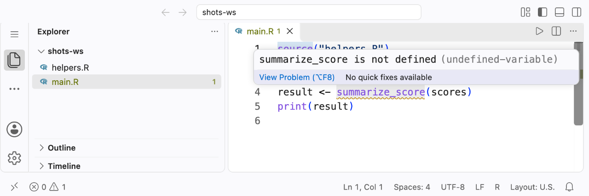

# Raven

Raven finds undefined variables and broken `source()` chains in R code, across files and as you type, without running your code. It is a language server for R, so the same analysis drives completion, go to definition, find references, and hover in VS Code, Neovim, Zed, or any editor that speaks the Language Server Protocol. A command-line `raven check` runs it in CI.

Here, `analysis.R` sources `helpers.R`, which defines `clean_names()`:

<!-- example: readme-demo file=analysis.R -->
```r
source("helpers.R")

survey <- clean_names(read.csv("survey.csv"))
summary(servey$age)

plot(fit)
fit <- lm(age ~ income, data = survey)
```

<!-- example: readme-demo -->
```console
$ raven check .
analysis.R:4:9 warning: servey is not defined [undefined-variable]
analysis.R:6:6 warning: fit is used before it is defined (defined on line 7) [undefined-variable]
2 issues (0 errors, 2 warnings, 0 infos, 0 hints, 0 notes)
```



*The same check in VS Code, from the [Getting started](docs/getting-started.md) tutorial (Raven 0.21.1).*

Raven knows `clean_names` came from `helpers.R`, so it doesn't flag it. It flags the typo and the plot that runs before the model exists. Style linters such as lintr and Jarl check how each line is written; Raven checks whether every name your code uses exists at that point, following `source()` across files, and it runs alongside them. In your editor, the same warnings appear as you type. No R session is involved, and the output above was produced with R turned off.

## Installation

- **VS Code:** install [Raven from the Marketplace](https://marketplace.visualstudio.com/items?itemName=jbearak.raven-r). The extension includes the language server.
- **Cursor, Positron, VSCodium:** install from [Open VSX](https://open-vsx.org/extension/jbearak/raven-r).
- **Other editors:** install the `raven` binary (below), then follow [Editor setup](docs/editor-integrations.md) for Neovim, Zed, Helix, Emacs, and others.

Open a folder of R files and Raven starts on its own: problems show up as squiggles and in the Problems panel, with nothing else to install and no R needed. [Getting started](docs/getting-started.md) walks through a first example in two minutes.

### Command line

The `raven` binary is the language server and the CLI.

- **macOS (Apple Silicon):** `brew install jbearak/raven/raven`. Use the full name, since Homebrew core has an unrelated `raven`.
- **Ubuntu:** use the signed apt repository. See [Ubuntu installation](docs/cli.md#ubuntu-installation).
- **Arch Linux:** the community AUR packages [raven](https://aur.archlinux.org/packages/raven) and [raven-bin](https://aur.archlinux.org/packages/raven-bin), maintained by Novica.
- **Anything else:** download a binary from the [releases page](https://github.com/jbearak/raven/releases), or build from source with `cargo install --git https://github.com/jbearak/raven raven`.

<a id="ci"></a>
To run Raven on every pull request, see [Raven in CI](docs/ci.md). GitHub Actions users can install it with `jbearak/setup-raven@v1`.

<a id="features"></a>
## What you get

<a id="code-intelligence"></a>
**Analysis**

- [Diagnostics](docs/diagnostics.md): undefined and used-before-defined variables, syntax errors, missing files and packages.
- [Cross-file analysis](docs/cross-file.md): follows `source()` chains, including computed paths and `{targets}` pipelines.
- [Non-standard evaluation](docs/non-standard-evaluation.md): dplyr columns, ggplot aesthetics, and other NSE are not flagged.
- [Package development](docs/r-package-dev.md), [box and import modules](docs/modules.md), and [`.Rprofile`](docs/rprofile.md) are modeled too.
- [Linting](docs/linting.md): opt-in style rules, configured with `raven.toml`, `.lintr`, or VS Code settings.
- [Directives](docs/directives.md): `# raven:` comments for what static analysis can't see.

**Navigation and editing**

- [Completion](docs/completion.md), [hover](docs/hover.md), [go to definition](docs/go-to-definition.md), and [find references](docs/find-references.md), across files.
- [Document outline](docs/document-outline.md), [indentation](docs/indentation.md) as you type, [syntax highlighting](docs/syntax-highlighting.md), and [snippets](docs/snippets.md).
- JAGS and Stan files get [highlighting](docs/syntax-highlighting.md#jags-and-stan), [completion](docs/completion.md#jags-and-stan), [definitions](docs/go-to-definition.md#jags-and-stan), [references](docs/find-references.md#jags-and-stan), [outlines](docs/document-outline.md#jags-and-stan-model-structure), [parse errors](docs/diagnostics.md#jags-and-stan-parse-errors), and Stan [undeclared-variable checks](docs/diagnostics.md#stan-undeclared-variables).

<a id="r-session-integration"></a>
**R session (VS Code)**

- An [R console](docs/r-console.md) that runs your installed R, with code sent straight from the editor.
- A [debugger](docs/debugger.md) with breakpoints, stepping, variables, and the Debug Console.
- [Plot](docs/plot-viewer.md), [data](docs/data-viewer.md), and [help](docs/help-viewer.md) viewers. The data viewer stays fast on millions of rows.

**R Markdown, Quarto, and CI**

- [Chunks](docs/chunks.md) with run buttons and full code intelligence, [R Markdown preview and export](docs/knit.md), and [Quarto preview and render](docs/quarto.md).
- [`raven check` and `raven lint`](docs/cli.md) for the command line and [CI](docs/ci.md).

<a id="how-raven-differs"></a>
## Why static analysis

Raven reads your files instead of asking a running R session what exists. That has four consequences:

- It answers the moment you open a file, even code that errors halfway or that you're only reading.
- It reflects what the file says, not what your session remembers from an hour ago.
- It never runs your code, so it is safe on any project and behind an AI agent.
- It runs anywhere, including CI, with no R installed.

[How Raven compares](docs/comparison.md) covers RStudio, Positron, vscode-R, lintr, Jarl, and Air.

## Works with your setup

Raven adds to the R tools you already use. Its language server runs alongside vscode-R's, and its R console and viewers step aside when vscode-R or Positron is present. [Using Raven with other R tools](docs/coexistence.md) explains each combination.

## Documentation

Project settings go in a `raven.toml` at the project root, which Raven finds by searching upward from the folder you open; VS Code settings and a `.lintr` work too. See [Configuration](docs/configuration.md).

All pages are listed in the [documentation hub](docs/README.md), and the [documentation site](https://jbearak.github.io/raven/) has the same pages with search. Start with [Getting started](docs/getting-started.md), and see [Troubleshooting](docs/troubleshooting.md) or the [FAQ](docs/faq.md) when something is unclear. Raven is under active development; bug reports and feedback are welcome in [issues](https://github.com/jbearak/raven/issues).

Raven's sibling project [Sight](https://github.com/jbearak/sight) is a language server for Stata with the same cross-file model.

<a id="editors"></a><a id="development"></a>
Contributors: [development notes](docs/development.md) cover building, testing, and internals.

<a id="provenance"></a>
## Acknowledgements

Raven builds on, learns from, and tests against these open-source projects. [NOTICE](NOTICE) has the license texts for the code Raven includes.

- **Where Raven started.** Raven began as the language server extracted from [Ark](https://github.com/posit-dev/ark) (Posit Software, PBC, MIT), which supplied its first LSP wiring and tree-sitter setup. Its cross-file model, the directives and the position-aware scope, comes from Raven's sister project [Sight](https://github.com/jbearak/sight) (GPL-3.0).
- **Parsing.** [tree-sitter-r](https://github.com/r-lib/tree-sitter-r) (Kevin Ushey, Jim Hester, Davis Vaughan, MIT) parses every R file Raven reads, on top of [Tree-sitter](https://tree-sitter.github.io/) (Max Brunsfeld and contributors, MIT). [tree-sitter-stan](https://github.com/WardBrian/tree-sitter-stan) (Brian Ward, MIT), pinned to an audited revision, parses Stan for syntax diagnostics. Raven wrote its own JAGS grammar and used both as structural references. The language server speaks LSP through [tower-lsp](https://github.com/ebkalderon/tower-lsp) (Eyal Kalderon, MIT or Apache-2.0).
- **Linting.** Raven's rules, its reading of `.lintr`, and its `# nolint` comments follow [lintr](https://github.com/r-lib/lintr) (Jim Hester, Michael Chirico and the lintr authors, MIT). Raven's compatibility tests adapt behavioral cases from lintr's test suite, and its list of base S3 generics is ported from lintr.
- **Stan and JAGS.** Raven generates its Stan function and distribution metadata with the [stanc3 npm package](https://github.com/WardBrian/npm-stanc3js) 2.39.1 (Brian Ward), which bundles the [Stan compiler](https://github.com/stan-dev/stanc3) 2.39.0 (Stan Development Team, BSD-3-Clause). Raven's JAGS parser and JAGS 4.3.2 catalog are clean-room interoperability artifacts built from independently authored syntax rules and factual metadata, checked against the official JAGS command line. The source URL and SHA-256 are kept for reproducibility. Raven does not copy or bundle JAGS code or documentation. Models published by the Stan and JAGS projects serve as a held-out test set and don't ship with Raven.
- **Package data.** Raven's downloadable package-symbol database is built from CRAN and Bioconductor metadata published by [r-universe](https://r-universe.dev), maintained by [rOpenSci](https://ropensci.org/r-universe/). See [Package database](docs/package-database.md#data-source-and-acknowledgement). The base-package data built into the binary is captured from R itself ([R Core Team](https://www.r-project.org/)). A regression suite runs `raven check` over the sources of published R packages, with thanks to their authors.
- **Syntax highlighting.** The bundled R and R Markdown TextMate grammars come from [vscode-R-syntax](https://github.com/REditorSupport/vscode-R-syntax) (REditorSupport, MIT). Knit Preview tokenizes code with [vscode-textmate](https://github.com/microsoft/vscode-textmate) and [vscode-oniguruma](https://github.com/microsoft/vscode-oniguruma) (Microsoft, MIT).
- **R session.** The console's line editor is [reedline](https://github.com/nushell/reedline) (the Nushell Project, MIT). The plot viewer shows plots from [httpgd](https://github.com/nx10/httpgd) (Florian Rupprecht, GPL-2.0 or later). The data viewer reads [Apache Arrow](https://arrow.apache.org/) files that the R `arrow` package writes and draws them with [Glide Data Grid](https://github.com/glideapps/glide-data-grid) (Glide, MIT). Its design borrows from RStudio's `View()`, Positron's Data Explorer, vscode-R, pillar, VisiData and julia-vscode. Knit Preview runs [knitr](https://yihui.org/knitr/) (Yihui Xie) and exports with [Pandoc](https://pandoc.org/) (John MacFarlane), and Quarto Preview runs [Quarto](https://quarto.org/).
- **Debugger.** Raven defines Ark's `.ark_annotate_source` hook, which [pkgload](https://github.com/r-lib/pkgload) and [shiny](https://github.com/rstudio/shiny) call, so breakpoints work in `load_all()` code and Shiny apps as they do in Positron. Several of the debugger's defaults and techniques come from Ark, RStudio, and [debugpy](https://github.com/microsoft/debugpy) (Microsoft, MIT).

## License

[GPL-3.0](LICENSE). See [NOTICE](NOTICE) for third-party attributions.
