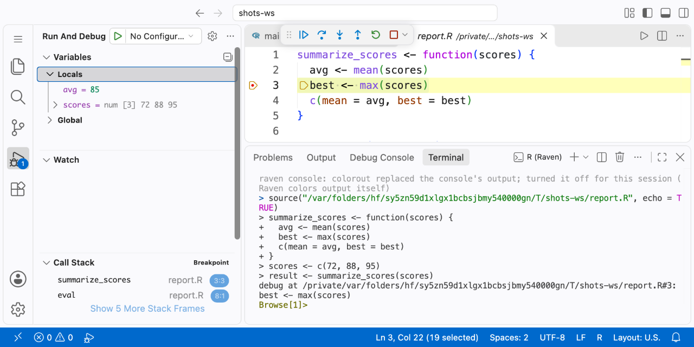

# Debugger

[Docs](README.md) › R session (VS Code)

Set breakpoints, step through code, and inspect variables in R scripts, R Markdown, and Quarto files from VS Code.

The debugger is built into Raven's [R console](r-console.md) and driven by R's own `browser()`, so everything you know from the console still works: typing `n` in the terminal and clicking Step Over do the same thing. You get breakpoints in `.R`, `.Rmd` and `.qmd` files, stepping, the call stack, a Variables view, watch expressions and the Debug Console.



*Stopped at a breakpoint in `summarize_scores()`: locals in the Variables view, the call stack, and R's `Browse[1]>` prompt in the console (Raven 0.21.1).*

## Getting started

You need Raven's console (`raven.rTerminal.program` = `raven`, the default). It works the same on macOS, Linux, and Windows.

1. Open an R file and click in the gutter to set a breakpoint.
2. Run the code that defines it with Run Line or Selection, Run Chunk, or Source File (`Cmd+Enter`, `Shift+Cmd+Enter`).
3. Call the code. When R reaches the breakpoint, VS Code switches to the debugger, showing the stopped line, the call stack and the variables.

You don't need a `launch.json`. VS Code attaches when R stops, whether at a breakpoint, at a `browser()` you wrote, in a function you `debug()`ed, or at an error in your code, and detaches when R gets back to the `>` prompt. When you run several expressions at once (a selection, Run All Chunks, a sourced file), the session lasts until all of them have run, so stopping again in a later one doesn't restart the debugger.

To attach before anything stops, run Raven: Start R Debugging. You need this to change an exception filter (for example, to stop on warnings) for the first time, because the filters live in the Breakpoints view of a running session (Raven remembers them per workspace after that).

F5 with an `.R` file open attaches and `source()`s that file, like running a Python script under the debugger; the session ends when the file has run. A `launch.json` entry with `"request": "launch"` and `"program"` does the same for a fixed script.

## What you can do while stopped

| Action | How |
|---|---|
| Continue, Step Over, Step Into, Step Out | Toolbar or F5/F10/F11/Shift+F11. These send R's own `c`, `n`, `s`, `f` |
| Stop | Toolbar Stop quits the browser (`Q`) and returns R to the prompt. With an `attach` configuration of your own the button is Disconnect, which lets R continue (`c`); Alt-click it to Stop |
| Look at variables | Variables view: locals of the selected frame, the enclosing environment, and the global environment. Long vectors and lists are paged |
| Watch an expression | Watch view, evaluated in the selected frame |
| Run R code | Debug Console, evaluated in the frame selected in Call Stack, with completions that include the frame's own variables. Output, messages and warnings appear in the Debug Console |
| Run R code in the terminal | Typing at `Browse[1]>` evaluates in R's browsed frame, as R defines |
| Hover over a name | Shows its value without running any R code (see [below](#hover-and-the-variables-view-never-run-your-code)) |
| Change a variable | Set Value in the Variables view, for variables and for elements of lists and vectors. The new value is an R expression evaluated where the variable lives |
| Open a data frame | Right-click it in the Variables view, then Open in Data Viewer |
| Copy a path to a value | Right-click, then Copy as Expression (for example `lst$b$x`) |

## Breakpoints

| Kind | Notes |
|---|---|
| Line breakpoints | In `.R`, `.Rmd` and `.qmd` files |
| Conditional | Stop only when an R expression is `TRUE` in the breakpoint's frame. A condition that errors stops and prints the error |
| Hit count | `5`, `>= 5`, `== 5`, `> 5`, `< 5`, `% 3` |
| Logpoints | Print a message instead of stopping; `{expr}` is evaluated in the frame. Output goes to the Debug Console |
| Function breakpoints | Breakpoints view, then + with a function name (`f`, or `pkg::f`). Uses `debug()`. See [function breakpoints](#function-breakpoints) below |
| Errors, warnings, interrupts | Exception filters in the Breakpoints view ([below](#errors-warnings-and-interrupts)) |

### Function breakpoints

A name that doesn't exist yet (or a package that isn't loaded) binds at the next prompt after it does, or, in a file you `source()`, right where the file defines it. Redefining the function re-binds it; your own `debug()` calls are left alone.

### When a breakpoint takes effect

R has no way to stop at a line of code that is already loaded, so Raven adds a small probe in front of the line when the code is *run from the editor*:

- Run Line or Selection, Run Chunk, Run All Chunks. Raven knows where the code came from, so breakpoints anywhere in it bind, including on top-level lines.
- Source File, and `source()` calls inside your scripts. A breakpoint in a sourced file binds when the file is sourced.
- `devtools::load_all()` and Shiny apps. pkgload (≥ 1.5) and shiny (≥ 1.13) ask the debugger to instrument the files they load, through the same hook Positron uses. Breakpoints in package code bind when `load_all()` runs.

A breakpoint shows as verified (solid red) once the code containing it has run. If you set a breakpoint in code that is already loaded, run that code again (re-run the function definition or re-source the file) to activate it.

During a debug session, hover over a hollow breakpoint to see why it isn't active. Before a session starts, VS Code draws every breakpoint solid; the R n/m item in the status bar counts the bound ones, and its tooltip lists the reasons for the rest. For example:

| Message | Meaning |
|---|---|
| not run in this session yet | The code hasn't been run since the breakpoint was set |
| not run since edit | The line changed since it was run; run it again |
| no expression on this line | Blank, a comment, or a closing `}` |
| inside `f()`: Raven can't verify this runs as code | The line is inside an argument to a function Raven doesn't know runs its argument as code, such as `quote()`, data.table's `dt[, { … }]`, or your own functions that use `substitute()`. A probe there could change the data the code builds |
| `local` is masked or not loaded | The code calls a function Raven checks before instrumenting, and the name now points somewhere else |
| sourced via an unsupported `source()` form | `source()` was called with a connection, a URL or unusual arguments |

Raven instruments through R's code-running functions, including `local()`, `tryCatch()` and its handlers, `with()`, `lapply()` and friends, `test_that()`, `observeEvent()`, `reactive()`, `render*()`, `R6Class()` methods and `setMethod()`/`setRefClass()` definitions. Before adding a probe inside one of them, Raven checks that the name really is that function and isn't redefined in the code being run.

A breakpoint on a line that only defines a function, like `sq <- function(x) x^2`, stops when the function runs, not when it is defined. Raven wraps the body in braces to hold the probe.

### Stepping

Steps behave as R defines them, with four conveniences:

- Back into the caller. Step Out, or Step Over past a function's last line, stops in the function that called it, even when you got there by a breakpoint (plain R's `f` and `n` would run on to the end).
- Across top-level lines. When you step past the end of one top-level expression of code you sent, the debugger stops at the start of the next one, as if the whole selection were one function.
- Just my code. Step Into a function that has no source (base R or an installed package) steps back out instead of showing R's internals. Turn this off with `raven.debugger.justMyCode`.
- No double stops. Stepping onto a line that has a breakpoint stops once.

## Errors, warnings and interrupts

The Breakpoints view lists three exception filters. Uncaught errors is on by default, as in Python's and Julia's debuggers; the other two are off:

| Filter | Default | Stops |
|---|---|---|
| Uncaught errors | On | Where an error is signalled, in your code, with the frames still alive |
| Warnings (not muffled) | Off | Where a warning is signalled |
| Interrupts | Off | When you press Ctrl+C, instead of returning to the prompt |

Errors and warnings stop only when code from a file is running: code you ran from the editor, a file you `source()`d, or a function such code defined. An error in something you type at the `>` prompt, such as `log("a")`, prints as usual, and so does one you type at `Browse[1]>` while already stopped. Code run from an unsaved editor has no file, so its errors don't stop either, and neither do errors in a file sourced with `source(keep.source = FALSE)`, unless that file has a breakpoint.

Errors caught by `tryCatch()` or `try()`, and warnings muffled by a local handler, never reach these filters; no R debugger can break on them without tracing `stop()` itself. After a stop on an error, Step Over lets the error continue.

### Tracebacks

When an error from code in a file reaches the `>` prompt, whether or not the debugger stopped on it, the console prints a short traceback under R's error message. It lists each function with the line where it called the next one, innermost first, and the top-level line, if it came from a file:

```
Error in log(x) : non-numeric argument to mathematical function
Traceback:
  inner(y) at /home/me/project/R/clean.R:2
  outer("a") at /home/me/project/R/clean.R:5
  <top level> at /home/me/project/analysis.R:1
```

Ctrl+click (Cmd+click on macOS) a location to open it. Frames without a file location, such as base R and installed packages, are left out, and so is the whole traceback when none of the code came from a file: a typo at the prompt still prints only R's error message. Errors you catch, and errors you end with Stop while the debugger is stopped on them, print no traceback.

### Where warnings came from

R's deferred warnings name the call that raised them, but not where it is. When a warning comes from code in a file, the console adds the line under R's warning block:

```
Warning messages:
1: In log(-1) : NaNs produced
2: In as.integer("q") : NAs introduced by coercion
Warning locations:
  1: /home/me/project/R/clean.R:2
  2: (no file)
```

A single warning gets `  at /path/file.R:2`. The location is the innermost line from one of your files on the call stack when the warning was raised, so for a warning inside a package function it is the line that called that function. Nothing is added when no warning came from a file, when R prints only a count (more than ten warnings), with `options(warn = 1)` or `suppressWarnings()`, or when Raven can't match its record to the warnings R printed.

Pause (the toolbar button) interrupts running R code and stops where it is. It can't stop compiled code that never checks for interrupts until that code returns.

## Hover and the Variables view never run your code

Showing variables never forces a lazy value (a promise), never calls an active binding, never calls a `print()` or `format()` method, and never reads a vector whose storage a package implements (an ALTREP class such as those from arrow or vroom; base R's own compact vectors are read). Values are shown from their underlying data: factors with their labels, `Date` and `POSIXct` as dates and times, data frames, tibbles and data.tables as their dimensions with paged columns. Hovering over `x`, `x$name`, `x[["name"]]` or `x@slot` reads the value directly; anything else needs the Debug Console.

The Debug Console and Watch run R code, as you'd expect. Watch expressions stop after two seconds of runtime (R checks this cooperatively, so compiled code may overrun). If an expression reaches a `browser()` or a `debug()`ged function, R continues past it and the Debug Console says so: the debugger is already stopped and can't stop again inside its own request.

## Settings

| Setting | Default | Effect |
|---|---|---|
| `raven.debugger.enabled` | `true` | Run the debugger in new R consoles |
| `raven.debugger.attach` | `onStop` | `onStop`: start a debug session when R stops. `never`: only when you start one |
| `raven.debugger.justMyCode` | `true` | Step Into skips functions without source |

See the [settings reference](settings-reference.md) for all settings.

## Limitations

- Consoles. The debugger works only with Raven's console, not with plain R, radian or arf.
- Code already loaded. Breakpoints bind when code runs from the editor, `source()`, or `load_all()`. A breakpoint set in a function that was defined earlier activates when you run the definition again. Ark/Positron has the same limitation. This includes breakpoints you add while stopped, and Run to Cursor, which works by adding a temporary breakpoint: in code loaded before the breakpoint existed, it continues instead.
- Stepping into callbacks. Step Into a call to base R or package code steps over it, including the functions you pass to it, as in `lapply(xs, function(x) …)` or an S3 method reached through `print()`. Set a breakpoint inside the callback instead; it binds when you run the code that defines it.
- Instrumented functions run slower. A function that holds a breakpoint isn't byte-compiled, so loops in it run several times slower until you remove the breakpoint and run it again. `print(f)` shows the probe lines.
- Rebinding base functions. If code redefines `local`, `if`, `with` or a similar function after it was instrumented, the probe can show up in data that code captures. Raven prints a notice when it sees such a rebinding in the global environment.
- Compiled code. A pause or error stop inside a function R has already byte-compiled steps like Continue on the first Step Over, as in plain R.
- Not supported: data breakpoints, Restart Frame, step back, editing a running function in place (live patching), and debugging Knit/Quarto renders (they run in separate R processes).

## Details

### What the debugger changes in your R session

- While any line or function breakpoint exists, `source()` is replaced by a wrapper that instruments the file being sourced and otherwise calls the original. `source(exprs = )`, connections and URLs go straight to the original. The original is put back when the last line breakpoint is removed.
- The base environment gets a few bindings: `.ark_annotate_source` (the hook pkgload and shiny call; Positron's Ark defines the same name) and `.raven_dbg_*` helpers the console calls at its own prompts.
- The option `raven.debug_hook` is set; probes call it.

## See also

- [R console](r-console.md)
- [Code chunks](chunks.md)
- [Data viewer](data-viewer.md)
