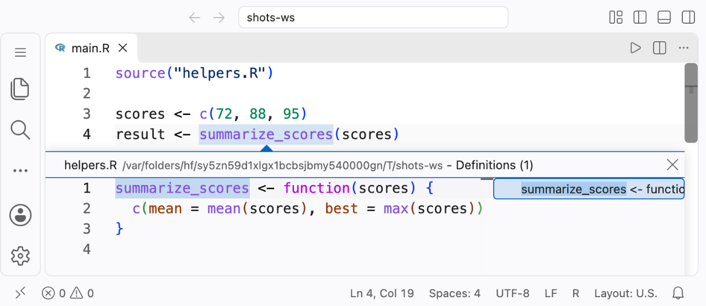

# Go to definition

[Docs](README.md) › Navigation and editing

Cmd-click a name (Ctrl-click on Windows and Linux, or press F12) to jump to where it is defined, whether that is earlier in the file, in a sourced file, or in a parent script.

```r
# main.R
source("utils.R")
result <- helper_function(42)  # Cmd-click helper_function: opens utils.R at its definition
```



*Peek Definition (Alt+F12) on a function defined in a sourced file (Raven 0.21.1).*

```r
# utils.R
helper_function <- function(x) { x * 2 }  # jump target
```

## What you can jump to

| At the cursor | Jumps to |
|---|---|
| A variable or function name | The most recent assignment in scope, in the same file or a sourced file |
| The name after `$` or `@` (`foo$bar`) | The member assignment or the named field in a constructor call; see [`$` and `@` member resolution](#-and--member-resolution) |
| A literal string in `[[` (`foo[["bar"]]`) | The same place as `` foo$`bar` ``, because `[[` extracts the same element as `$` |
| A symbol declared with `# raven: var` or `# raven: func` | The directive line; see [Declared symbols](#declared-symbols) |
| A file path in `source()` or a path directive | The file, opened at the top |
| A static relative or configured module path in `box::use()` | The module file, or its `__init__.r` / `__init__.R` |
| An exported member of a box namespace alias, or an attached or renamed box binding | The original definition in the local module, including through named, renamed, and wildcard re-exports. Members of installed packages don't navigate. |
| A literal `.R`/`.r` script or a selected or renamed local member in a static `import::` call | The script file, or the member's original top-level definition |
| A name in a `.stan`, `.jags`, `.bugs`, or `.bug` file | The most recent definition at or before the cursor, or the first one if the cursor comes before all of them; see [JAGS and Stan](#jags-and-stan) |

## Position-aware resolution

Raven jumps only to definitions that exist at the cursor when the code runs. Cmd-clicking a variable above its assignment doesn't jump to the later assignment:

```r
x  # no jump: x isn't defined yet
x <- 1
x  # jumps to the line above
```

Inside function bodies, global definitions are hoisted, because R looks globals up when the function runs. A function body can jump to a helper defined below it at file scope. Variables local to the function stay strictly positional. See [Global symbol hoisting](cross-file.md#global-symbol-hoisting).

## Cross-file navigation

When a name is defined in a sourced file, Cmd-click opens that file with the cursor on the definition, as in the example at the top of this page.

Raven follows both `source()` calls and [forward directives](directives.md#forward-directives) (`# raven: source`, `# raven: run`, `# raven: include`). Backward directives (`# raven: sourced-by`, `# raven: run-by`, `# raven: included-by`) bring the parent file's symbols into scope, so Cmd-clicking a parent's symbol in a child file works too.

If Raven finds no definition through `source()` links, it falls back to other open files and the workspace index, so you can still reach a likely candidate while exploring a project.

## `$` and `@` member resolution

When you Cmd-click the name after `$` or `@` (for example `host` in `config$host`), Raven looks for it as a member of `config`, not as a free variable. It searches:

- member assignments: `config$host <- …` and `config[["host"]] <- …` for `$`, `object@slot <- …` for `@`
- constructor calls: named arguments in `list()`, `data.frame()`, `tibble()`, `c()`, S4 `new()`, and similar

Nested members resolve against the full path at any depth. Cmd-clicking `gamma` in `alpha$beta$gamma` looks for a member of `alpha$beta`, through nested constructor calls or `alpha$beta$gamma <- …` assignments, never for a free variable `gamma`. A chain can mix `$`, `@`, and `[["lit"]]` steps.

`foo[["bar"]]` extracts the same element as `foo$bar`, so Cmd-clicking the string jumps where `` foo$`bar` `` would. This helps with names that need quoting, such as `df[["weird col"]]`. It applies only to a single literal string in `[[ ]]`; see [the exact rule](#which-subscripts-navigate) below.

When several candidates exist in connected files, the closest file wins. Cmd-clicking the `$` or `@` itself does nothing. For the full scope rules, see [`$` and `@` member resolution](cross-file.md#-and--member-resolution) in Cross-file analysis.

## Declared symbols

Symbols declared with [`# raven: var` or `# raven: func`](directives.md#declaration-directives) are navigable. Cmd-click jumps to the start of the directive line. If a file declares the same name more than once, Raven jumps to the first declaration:

```r
# raven: var config   ← jump target (first declaration)
load("config.RData")
# raven: var config   ← later duplicate, not used
use(config)
```

[Diagnostics](diagnostics.md) and [completion](completion.md) also treat the first declaration as the canonical one. [Hover](hover.md#declared-symbols) differs: it shows the most recent declaration at or before the cursor.

## File path navigation

Inside `source()` strings and path-taking directives, Cmd-click opens the file. Paths resolve by Raven's usual rules:

- `source()` calls and forward directives respect `# raven: cd`.
- Backward directives (`# raven: sourced-by`, `# raven: run-by`, `# raven: included-by`) resolve relative to the file's own directory and ignore `# raven: cd`.
- `source()` calls and forward directives (`# raven: source`, `# raven: run`, `# raven: include`) fall back to the workspace root, but only when no working directory is set.

See [Cross-file analysis](cross-file.md#automatic-source-detection) and [Directives](directives.md#working-directory-directives) for details.

### box module paths and exports

Cmd-click on a static relative or configured [`box::use()` module path](modules.md#box-modules-boxuse) opens the module it resolves to. Explicit relative paths start from the importing file's directory. Qualified paths use the configured search paths, defaulting to the nearest `rhino.yml` root. Resolution is case-sensitive, ignores the `source()` working-directory and fallback rules, and tries `path.r`, `path.R`, `path/__init__.r`, then `path/__init__.R`.

For namespace aliases and attached or renamed bindings, navigation crosses only the exported interface. `$`, `@`, and a single literal-string `[[...]]` access jump to the original definition in the local module, following named, renamed, or wildcard re-exports and stopping safely if a chain loops. Private names and names imported only indirectly don't navigate. Box imports of installed packages use the package's export list but don't navigate, like other installed package exports.

<a id="load_all-internals"></a>

## Package code under `load_all()`

When a file calls `devtools::load_all()` or `pkgload::load_all()`, Raven treats it as loading the package you're developing. Cmd-click on anything `load_all()` exposes, including non-exported helpers in `R/`, jumps to its definition in the package source, whether or not that file is open.

```r
# internal/scratch.R
devtools::load_all()
my_helper(data)   # Cmd-click jumps to R/helpers.R, where my_helper is defined
```

The same works between files in `R/`: a function defined in `R/utils.R` and called from `R/main.R` is navigable without a `source()` call.

## Package exports

Cmd-click on a symbol from an installed package (for example `mutate` after `library(dplyr)`, or `dplyr::mutate`) doesn't navigate. Installed packages ship compiled lazy-load databases rather than readable source. Use hover to see the `{package}` attribution, and read the function in its documentation or source repository. Raven still uses package exports for completion, diagnostics, and hover.

## R Markdown and Quarto

Go to definition works inside R chunks of `.Rmd` and `.qmd` documents. Raven treats all the R chunks as one script, so you can jump from a use in one chunk to a definition in an earlier chunk. On prose, YAML front matter, or a non-R chunk, it finds nothing. Hover and find references behave the same way.

## JAGS and Stan

In `.stan`, `.jags`, `.bugs`, and `.bug` files, go to definition works within the current file. The JAGS extensions are matched case-insensitively and mean strict JAGS, not general OpenBUGS, WinBUGS, MultiBUGS, or NIMBLE compatibility.

| Language | Jumps to |
|---|---|
| Stan | The most recent declaration of the variable or function at or before the cursor, or the first one if none comes before it |
| JAGS | The most recent assignment at or before the cursor, or the first one if none comes before it. For data inputs and constants with no assignment, the first occurrence. |

Raven doesn't follow these languages across files. File-path navigation, such as Cmd-click on a path in `# raven: sourced-by`, still works. See also [Find references: JAGS and Stan](find-references.md#jags-and-stan).

## Limitations

- No navigation into installed packages; see [Package exports](#package-exports).
- `x[[i]]`, `x[[1]]`, `x["bar"]`, and other computed or multi-argument subscripts don't navigate as members.

## Details

### Which subscripts navigate

Only a single, positional, literal string subscript navigates like `$`. These don't:

- computed subscripts: `x[[i]]`, `x[[paste0("a", "b")]]`
- numeric indices: `x[[1]]`
- named or multi-argument subscripts: `x[[name = "a"]]`, `x[["a", exact = FALSE]]`
- single brackets: `x["bar"]`, which returns a sub-container rather than the element

This is separate from `foo["bar"] <- …` assignments, which are still candidates when Raven looks for a member's definition.

### JAGS fallback occurrences

When the JAGS fallback picks the first occurrence of a name, it skips occurrences that are built-in syntax or calls to catalog functions. The same spelling in an ordinary data-variable position is still navigable.

<a id="related"></a>

## See also

- [Find references](find-references.md)
- [Hover](hover.md)
- [Cross-file analysis](cross-file.md)
- [Directives](directives.md)
